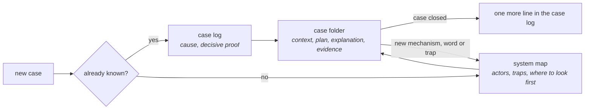

# Tenir le savoir : chaque cas rend le suivant plus rapide

*En une phrase : ce qu'on apprend en travaillant s'écrit là où on le relira au cas suivant, sinon on
le réapprend, et on se trompe autrement.*

Le savoir d'une enquête vit dans la tête de celui qui l'a menée et dans une conversation qui sera
oubliée : le même symptôme revient trois mois plus tard, et l'enquête repart de zéro. Un agent n'a pas
de mémoire d'une session à l'autre, donc pour lui ce qui n'est pas écrit n'existe pas. La carte de
travail d'`explorer-le-code` (section 7) dure le temps d'une exploration ; ce skill tient celle qui
dure, relue à l'ouverture de chaque cas et enrichie à sa fermeture.

## 1. Quatre formes, une question chacune

Si deux formes répondent à la même question, l'une des deux mentira (`doc-derivee`).

| Forme | La question | Sa durée de vie |
|---|---|---|
| la **carte d'un système** | comment ça marche, et où ça casse d'habitude ? | tenue à jour ; chaque fait porte sa source et sa date |
| le **journal des cas** | est-ce déjà arrivé, et qu'est-ce qui l'a prouvé ? | on ajoute, on ne réécrit pas : chaque ligne est datée |
| le **dossier d'un cas** | que sait-on de ce cas, que fait-on, comment l'expliquer ? | fermé avec le cas, relu s'il revient |
| la **carte des pannes** | tel symptôme : où regarder d'abord ? | tirée du journal, classée par fréquence mesurée (`trouver-la-cause`) |

## 2. La carte d'un système

Ce qu'on lit avant d'enquêter dans un système, et ce qu'on enrichit en fermant un cas :

- **les acteurs**, dans une table avec une colonne d'analogie (`se-faire-comprendre`, section 6) ;
- **un schéma** du chemin principal, dont chaque étape dit comment elle se fait ;
- **les mots** : un glossaire, utile parce qu'une carte se consulte (`se-faire-comprendre`, section 9) ;
- **les pièges** : ce qui casse en silence, chacun avec sa signature ;
- **les cas connus** : une ligne par cas, avec le lien vers son dossier ;
- **les ponts** : là où un chemin passe dans un autre système, la carte nomme la carte voisine à la
  frontière, et le mécanisme commun s'explique dans une seule des deux.

Trois règles la gardent vraie. **Elle ne contient que du vérifié**, chaque fait avec sa source
(`fichier:ligne`, une commande, une route et l'heure) et sa date, et le supposé le dit (les statuts
de `challenger-le-sujet`, section 2). **Elle renvoie au code plutôt que de le paraphraser** : une
description du présent expire en silence (`doc-derivee`), la source et la date disent quand la
revérifier. **Un mécanisme s'y explique une fois**, dans la carte de son système, et tout le reste y
renvoie (`se-faire-comprendre`, section 5).

## 3. Le journal des cas : une ligne par cas

| Date | Symptôme | Cause | Couche | Preuve décisive | Fausse piste | Délai |
|---|---|---|---|---|---|---|
| 2026-03-04 | « le contrat du 15 est facturé au mois plein » | aucune proratisation en début de mois | calcul | le montant recalculé à la main sur le contrat réel | le cache des tarifs | 2 h |

Chaque colonne sert le cas suivant : le symptôme **dans les mots de celui qui l'a signalé**, parce que
c'est ce que le prochain cherchera ; la **preuve décisive**, qui dit où regarder ; la **fausse piste**,
que le prochain voudra prendre ; le **délai**, du signalement à la cause prouvée, qui dit si la
méthode progresse. Daté et jamais réécrit, le journal ne périme pas : il porte une date, pas un état
(le critère du wiki de `doc-derivee`). Compté par famille de symptôme, il donne la carte des pannes de
`trouver-la-cause`.

## 4. Le dossier d'un cas, ouvert dès le premier jour

Il s'ouvre avec le cas, pas à la fin : un contexte reconstruit de mémoire a perdu ses statuts. Le
contexte et l'explication sont les deux documents de `se-faire-comprendre` (section 1), l'un pour
comprendre, l'autre pour être compris.

| Pièce | Pour qui | Ce qu'elle porte |
|---|---|---|
| le **contexte** | soi | chaque fait avec son statut : vérifié (avec sa source), rapporté (par qui), supposé, inconnu |
| le **plan** | celui qui décide | le cas en quatre phrases (problème, cause, changement, preuve), le critère du juge et son budget (`cadrer-et-planifier`), les prédictions écrites avant de mesurer (`mesure-et-telemetrie`), les décisions datées |
| l'**explication** | celui qui reprendra | voir ci-dessous |
| les **preuves** | les deux | le brut : sorties, réponses, captures. Le volumineux reste dehors, avec son chemin |

**L'explication tient en une page**, dans cet ordre : un « en bref » lisible seul ; un exemple réel ;
les acteurs absents de la carte, avec leur analogie ; un schéma dont chaque étape dit comment ; l'avant
et l'après ; ce qu'on sait et à quel point (mesuré, lu dans le code, supposé) ; le mot à retenir, qui
rejoint le glossaire de la carte ; le réflexe qui a trouvé la cause, pour le refaire seul ; et comment
vérifier soi-même, une commande ou un lien, avec ce qu'on doit voir.

## 5. Ouvrir et fermer : les deux gestes qui font tourner la boucle

**En ouvrant**, chercher si le cas est déjà connu (la première question de `trouver-la-cause`). **En
fermant, le jour même**, parce que le lendemain le détail qui comptait est parti :

1. une ligne au journal des cas ;
2. la carte du système enrichie : le cas connu, le mot, le piège, le réflexe de diagnostic s'il est neuf ;
3. chaque correction reçue pendant le cas (« je te l'ai déjà dit », « vérifie avant d'écrire ») met à
   jour la règle qu'elle vise, une note, une carte ou un skill, avant de rendre la main.

## 6. Trier sans perdre : archiver, jamais supprimer

Sans tri, le savoir devient un fichier que plus personne ne relit (`doc-derivee`). À date fixe :

- **ce qui n'est plus vrai s'archive, daté**, avec ce qui l'a remplacé. Supprimé, il casse les liens
  du journal, et l'ancien cas devient illisible ;
- **deux notes qui disent la même chose fusionnent**, et l'ancienne pointe vers la nouvelle ;
- **une règle devenue un contrôle** (un test, un hook) se réduit au lien vers ce contrôle ;
- **une note dont on ne connaît pas la raison** ne se retire qu'après l'avoir trouvée (la barrière de
  Chesterton, `explorer-le-code`, section 6).

Pour un agent, la base se charge par un **index court**, une ligne par note, et la note se lit quand sa
ligne correspond au geste en cours. L'index est chargé à chaque session : chaque ligne s'y paie.

## 7. Savoir si ça marche : les indicateurs de session

Une base de savoir se juge à ce qu'elle épargne. Quatre compteurs, relevés en relisant les sessions :

| Indicateur | Ce qu'il compte | Ce qu'il dit |
|---|---|---|
| les **rappels** | les fois où l'humain a redit une règle déjà donnée | une règle non écrite, ou écrite là où on ne la lit pas au moment du geste |
| les **interruptions** | les relances, les changements de cap, les questions qu'on aurait pu trancher seul | une autonomie qui manque, ou une question mal posée |
| les **revues reçues** | les remarques par PR, et celles qu'une règle écrite couvrait déjà | une règle lue trop tard |
| le **délai** du journal | du signalement à la cause prouvée, par famille | si les cartes servent |

Une règle qui coûte plusieurs rappels monte d'un cran : d'une note vers le skill de son geste, d'un
skill vers un contrôle qui la vérifie.

## Les anti-patterns, et leur signature

- **le savoir dans la conversation.** Signature : « on avait déjà vu ça », sans lien ;
- **la carte qui paraphrase le code.** Signature : une phrase sans source ni date, que le code dément ;
- **le tri qui supprime.** Signature : un lien mort dans le journal.

## La porte de sortie

Avant de rendre un cas, ces six réponses doivent exister :

1. la recherche « déjà connu ? » a été faite **avant l'enquête**, et elle dit où elle a regardé ;
2. le **dossier du cas** existe depuis son ouverture, chaque fait du contexte avec statut et source ;
3. le cas a **sa ligne au journal**, avec sa preuve décisive et sa fausse piste ;
4. la **carte du système** est enrichie, chaque ajout daté et sourcé, chaque mécanisme expliqué une fois ;
5. chaque **correction reçue** pendant le cas a mis à jour la règle qu'elle vise ;
6. **rien n'a été supprimé** au tri : ce qui n'est plus vrai est archivé et daté.
